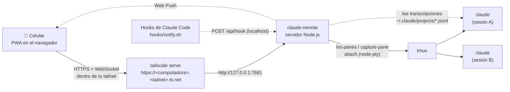

<div align="center">

# claude-remote

**Maneja desde el celular las sesiones de Claude Code que corren en tu computadora.**

Una PWA pequeña y autoalojada que lista todas las sesiones de Claude Code que corren en tmux y muestra qué está haciendo cada una.
Desde cualquier lugar puedes responder, aprobar, interrumpir y crear sesiones, en privado a través de tu red de Tailscale.

[](https://nodejs.org)
[](LICENSE)
[](#6-instalar-en-el-celular)
[](https://tailscale.com)

[English](README.md) · **Español**


</div>

> [!NOTE]
> La interfaz de la app está en **español**.

---

## Contenido

- [Qué es](#qué-es)
- [Funciones](#funciones)
- [Cómo funciona](#cómo-funciona)
- [Requisitos](#requisitos)
- [Instalación](#instalación)
- [Uso de la app](#uso-de-la-app)
- [El comando `ct`](#el-comando-ct)
- [Configuración](#configuración)
- [Modelo de seguridad](#modelo-de-seguridad)
- [Problemas frecuentes](#problemas-frecuentes)
- [Contribuir](#contribuir)
- [Licencia](#licencia)

## Qué es

Arrancas Claude Code en tu computadora, trabaja un rato y se detiene a preguntar
*"Do you want to make this edit?"* justo cuando no estás frente a ella. **claude-remote** te deja
responder desde el celular.

No usa ninguna función "remote" de Claude Code. Se apoya en dos herramientas que quizá ya usas:

- **tmux**: tus sesiones de Claude Code corren dentro de paneles de tmux, así que siguen vivas y quien tenga el acceso correcto puede unirse a ellas.
- **Tailscale**: el celular llega a tu computadora por tu tailnet privada con HTTPS real (`tailscale serve`), sin abrir puertos y sin exponer nada a internet.

El servidor es un solo proceso de Node.js (sin frameworks ni paso de compilación) que escucha en `127.0.0.1`.

## Funciones

| | |
|---|---|
| 🗂️ **Lista de sesiones con estado en vivo** | Encuentra cada panel de tmux en cuyo árbol de procesos corre `claude` y lo muestra como tarjeta. El estado es **Espera respuesta** (ámbar y pulsando), **Trabajando** (naranja, girando) o **Libre** (verde), junto a las últimas líneas de la pantalla. Las que esperan respuesta salen primero y el título de la pestaña dice cuántas hay. Se actualiza cada 3 s; jala hacia abajo para recargar al instante. |
| 🖥️ **Terminal en vivo** | Abre la sesión real de tmux en [xterm.js](https://xtermjs.org) por WebSocket. Es la misma sesión que ves en la computadora, no una copia. |
| ⌨️ **Teclas especiales + Detener** | Un teclado de dos filas: `1` `2` `3` para responder menús, `Esc`, `Tab`, `⇧Tab` para cambiar de modo, `↑` `↓`, `⏎`, tamaño de letra `A−`/`A+` y un botón rojo **Detener** que manda **Ctrl+C**. |
| ✍️ **Caja de prompt** | Para escribir prompts largos con comodidad. El texto de varias líneas se manda como "pegado" (bracketed paste) para que los saltos de línea no lo envíen antes de tiempo. **Ctrl/⌘+Enter** envía. |
| 📎 **Adjuntar imágenes** | Elige una foto o captura. Se achica a 2000 px como máximo en el celular, se sube a tu computadora y su ruta se pega en Claude, que la adjunta como `[Image #N]`. |
| 💬 **Historial tipo chat** | Lee la transcripción de Claude Code (`.jsonl`) y la muestra como chat: tus mensajes, las respuestas de Claude con Markdown y bloques de código, y las herramientas agrupadas en filas plegables. Si no encuentra la transcripción, muestra el scrollback de tmux. |
| 🔔 **Avisos push** | Con los hooks opcionales de Claude Code, el celular recibe un aviso cuando Claude necesita permiso o tu atención. Al tocarlo se abre esa sesión. |
| ➕ **Sesión nueva con buscador de proyectos** | Arranca Claude en cualquiera de tus repos: busca por nombre o carpeta (sin importar tildes ni mayúsculas, los recientes primero) o escribe una ruta. Elige el comando o alias y, si quieres, un nombre para la sesión. |
| 🏷️ **Títulos de `/rename`** | Si le pusiste nombre a la conversación con `/rename` de Claude Code, se muestra ese nombre en vez del de la carpeta. |
| 📱 **PWA instalable** | Agrégala a la pantalla de inicio y se abre a pantalla completa como una app nativa. Pensada primero para el celular, con soporte de safe areas, botones grandes y un tema grafito oscuro con acentos naranjas. También funciona bien en escritorio. |

<table>
<tr>
<td align="center"><br><sub>Lista de sesiones</sub></td>
<td align="center"><br><sub>Terminal en vivo + teclas</sub></td>
<td align="center"><br><sub>Historial tipo chat</sub></td>
</tr>
</table>

## Cómo funciona



<details>
<summary>Versión en texto</summary>

```
Celular (PWA) ──HTTPS por Tailscale──▶ tailscale serve ──▶ claude-remote (127.0.0.1:7681) ──▶ tmux ──▶ claude
                                                               ▲
                           Hook de Claude Code (notify.sh) ────┘ ──Web Push──▶ celular
```
</details>

- **Detección**: `tmux list-panes -a` y, por cada panel, recorre el árbol de procesos en `/proc` buscando un proceso llamado `claude`.
- **Estado**: se deduce de lo que hay en pantalla. Un aviso de permiso o de elegir opción es *Espera respuesta*, "esc to interrupt" es *Trabajando* y cualquier otra cosa es *Libre*.
- **Terminal**: `node-pty` ejecuta `tmux attach-session -t <panel>` y lo transmite a xterm.js. Cerrar la página solo se desconecta; nunca cierra la sesión.
- **Historial**: encuentra la transcripción de la sesión con `/proc/<pid>/environ` (`CLAUDE_CONFIG_DIR`) y `<config>/sessions/<pid>.json`, y lee los últimos 8 MB del `.jsonl`.
- **Avisos**: los hooks `Notification` y `Stop` de Claude Code llaman con `curl` al servidor local, que manda un Web Push (VAPID) a tus dispositivos suscritos. No avisa de una sesión que estás viendo en ese momento en la app.

## Requisitos

| | |
|---|---|
| **Sistema** | **Linux.** La detección de sesiones lee `/proc`, así que macOS y Windows no sirven como anfitrión. Como cliente sirve cualquier navegador de celular o escritorio. |
| **Node.js** | ≥ 20 |
| **Herramientas de compilación** | `node-pty` es un módulo nativo: necesitas `python3`, `make` y un compilador de C++ (`sudo apt install build-essential python3`) |
| **tmux** | `sudo apt install tmux` |
| **Claude Code** | El CLI `claude`, o un alias o script que lo llame |
| **Tailscale** | En la computadora y en el celular, con **MagicDNS** y **HTTPS Certificates** activos en la consola (DNS → HTTPS Certificates) |
| **systemd** *(opcional)* | Para arrancarlo solo como servicio de usuario |

## Instalación

### 1. Clonar e instalar

```bash
git clone https://github.com/egoan82/claude-remote.git ~/claude-remote
cd ~/claude-remote
make install          # npm ci (compila node-pty y genera los íconos)
```

### 2. Probarlo en local

```bash
make start            # igual que: PORT=7681 node server.js
```

Abre <http://localhost:7681> en la misma computadora. El acceso local siempre está permitido.
En otra terminal arranca una sesión con `ct` (ver [más abajo](#el-comando-ct)) o con `tmux new -s demo claude`, y aparecerá en la lista.

### 3. Servicio de systemd (de usuario)

`claude-remote.service` es una **plantilla**. Edítala antes de instalarla:

```ini
WorkingDirectory=%h/claude-remote                   # dónde clonaste el repo
Environment=PATH=%h/.local/bin:/usr/local/bin:/usr/bin:/bin   # node, tmux y claude deben estar aquí (agrega el bin de nvm si lo usas)
Environment=ALLOWED_LOGINS=you@example.com          # tu usuario de Tailscale
Environment=ALLOWED_IPS=100.x.y.z,100.a.b.c         # IPs de Tailscale de tu celular (y de esta computadora)
Environment=CLAUDE_CMDS=claude                      # comandos/alias que ofrece "Nueva"
Environment=PROJECT_ROOTS=%h/projects:%h/code       # dónde están tus repos
```

Luego:

```bash
make install-service  # la copia a ~/.config/systemd/user y la activa (arranca al iniciar sesión)
make status           # estado del servicio + tailscale serve status
```

`KillMode=process` hace que reiniciar el servicio nunca cierre tus sesiones de tmux.
Para quitarlo: `make uninstall-service`.

> [!TIP]
> Para que siga corriendo aunque cierres tu sesión de usuario: `loginctl enable-linger $USER`.

### 4. Publicarlo en tu tailnet

```bash
make serve            # tailscale serve --bg --https=443 http://127.0.0.1:7681
```

La app queda en `https://<computadora>.<tailnet>.ts.net` (lo muestra `tailscale serve status`), **solo dentro de tu tailnet**.
`make unserve` la quita.

> [!IMPORTANT]
> El acceso por la tailnet está **cerrado por defecto**. Configura `ALLOWED_LOGINS` y/o `ALLOWED_IPS`
> (o, si de verdad quieres que cualquier dispositivo de tu tailnet tenga una terminal, `ALLOW_ANY_TAILNET=1`).
> Las IPs salen en `tailscale status` / `tailscale ip -4`.

**Opcional: ciérralo también a nivel de red.** [`docs/tailscale-acl.hujson`](docs/tailscale-acl.hujson) es una política de
ejemplo de Tailscale en la que solo tu celular puede llegar a tu computadora. Cambia los hosts e IPs de ejemplo por los tuyos,
intégrala en *Access controls* de la consola de Tailscale y revísala con *Preview rules* antes de guardar.

### 5. Avisos push (opcional)

Registra los hooks en cada carpeta de configuración de Claude Code que uses:

```bash
make hooks DIRS="~/.claude"
# varias configuraciones (p. ej. un perfil de trabajo con CLAUDE_CONFIG_DIR=~/.claude-work):
make hooks DIRS="~/.claude ~/.claude-work"
```

Agrega un hook `Notification` y uno `Stop` que ejecutan `hooks/notify.sh`. El script es idempotente y guarda un respaldo
`settings.json.bak-claude-remote` antes de escribir. El hook nunca bloquea a Claude: usa un timeout de 3 s y
siempre sale con 0, así que si el servidor está apagado no pasa nada.

- Recibes aviso cuando Claude **necesita permiso** o **tu atención**.
- Los avisos de "terminó y espera tu siguiente mensaje" vienen **apagados**, porque son demasiado frecuentes. Actívalos con `NOTIFY_ON_STOP=1`.
- Si el servidor no está en el puerto 7681, define `CLAUDE_REMOTE_PORT` en el entorno donde corre Claude.

### 6. Instalar en el celular

1. Abre Tailscale en el celular y luego `https://<computadora>.<tailnet>.ts.net` en el navegador.
2. **Android/Chrome**: menú ⋮ → *Agregar a la pantalla principal*. **iPhone/Safari**: Compartir → *Agregar a inicio*.
3. Ábrela desde la pantalla de inicio y toca la 🔔 para activar los avisos. Te llegará uno de prueba.

Hace falta HTTPS para instalar la PWA y para recibir avisos; por eso pasa por `tailscale serve`.

## Uso de la app

### Lista de sesiones


Cada sesión de Claude Code que corre en tmux aparece como una tarjeta:

- **Nombre**: el título de `/rename` o el nombre de la carpeta.
- **Estado**:
  - 🟠 **Espera respuesta**: Claude te está esperando (un permiso o una elección). Brilla en ámbar y sale primero.
  - 🔶 **Trabajando**: Claude está trabajando.
  - 🟢 **Libre**: lista para otro prompt.
- **Línea de datos**: el destino de tmux (`sesión:ventana.panel`), la carpeta y un ícono de monitor 🖥️ si la sesión también está abierta en otra terminal.
- **Vista previa**: las últimas líneas de la pantalla.
- **Sin terminal**: si ninguna terminal tiene abierta la sesión (por ejemplo, cerraste la pestaña sin salir de Claude), la tarjeta lleva una barra roja a la izquierda y una franja que lo explica, con dos botones: **Abrir en la laptop** abre una ventana de terminal en la laptop unida a la sesión (`LAPTOP_TERMINAL`), y **Cerrar** la cierra tras confirmar. La conversación queda guardada y la retomas con `ct -- --resume`.
- **Claude terminó**: si Claude ya salió y solo queda el shell, la tarjeta lo indica y solo ofrece **Cerrar** para quitarla. Si ese shell sigue abierto en una terminal de la laptop (lo que deja `ct`), al cerrarlo también se cierra esa terminal. Nunca aparecen shells con un proceso corriendo, ni shells de tmux abiertos a mano en una terminal.

Toca una tarjeta para abrirla. La lista se actualiza cada 3 segundos mientras está a la vista; **jala hacia abajo** para recargar al instante.
Sin sesiones aparece un mensaje que explica cómo crear una. Si no hay conexión con el servidor, lo indica un aviso rojo.

<br clear="right">

### Sesión nueva ("Nueva")


Toca **Nueva** en la barra superior:

1. **Proyecto**: busca entre tus repos. Aparece cada repositorio git que esté directamente dentro de una carpeta de `PROJECT_ROOTS`. Busca por nombre y por carpeta, sin importar tildes ni mayúsculas, y los usados hace poco salen primero. También puedes escribir una ruta que empiece con `/` o `~/`. **Enter** elige el primer resultado.
2. **Comando**: qué comando o alias ejecutar (de `CLAUDE_CMDS`). Recuerda el último que usaste.
3. **Nombre (opcional)**: nombre de la sesión de tmux. Por defecto es el de la carpeta, con `-2`, `-3`… si ya existe.
4. **Crear** la arranca en segundo plano: `tmux new-session -d -c <carpeta> $SHELL -ilc '<cmd>; exec $SHELL -il'`. Usa un shell interactivo de login, así funcionan tus alias y tu PATH, y al salir de Claude te queda el shell.

<br clear="right">

### Terminal


La sesión real de tmux, en vivo. La barra muestra el nombre, un indicador de **conexión** (Wi-Fi verde si está conectada; Wi-Fi tachado en rojo si no, y se reconecta sola) y el botón de **historial**.

| Tecla | Manda | Para qué |
|---|---|---|
| **Detener** | `Ctrl+C` | Interrumpir / detener a Claude |
| `1` `2` `3` | el número | Responder menús numerados ("1. Yes / 2. … / 3. No") |
| `A−` `A+` | — | Tamaño de letra de la terminal (se recuerda en el dispositivo) |
| ⎋ **Esc** | `Esc` | Cancelar / volver en la interfaz de Claude |
| ⇥ **Tab** | `Tab` | Autocompletar |
| ⇤ **⇧Tab** | `Shift+Tab` | Cambiar de modo (p. ej. aceptar ediciones / modo plan) |
| ↑ ↓ | flechas | Moverse por menús y por el historial de prompts |
| ↵ **Enter** | `Enter` | Confirmar |

Las teclas no le quitan el foco a la caja de texto, así que el teclado del celular no se cierra.

**Caja de prompt**: escribe y toca el botón de enviar (**Enviar**). Si está vacía, solo manda Enter.
Los prompts de varias líneas se mandan como pegado. **Ctrl/⌘+Enter** envía desde un teclado físico.

**📎 Adjuntar imagen**: elige una imagen (png, jpg, gif o webp, hasta 20 MB). Las fotos grandes se achican a 2000 px y se recodifican como JPEG en el celular.
Se guardan en la computadora en `$TMPDIR/claude-remote-uploads/` (permisos 0700; se borran al día) y su ruta se pega en el prompt.

<br clear="right">

### Historial


Toca el ícono del reloj para leer la conversación completa con calma:

- **Tus mensajes** van a la derecha en burbujas naranjas. **Los de Claude** van a la izquierda con Markdown: títulos, listas, negritas, código en línea y bloques de código con scroll horizontal.
- **Las herramientas** aparecen como filas compactas con un ícono por tipo (terminal para Bash, archivo para Read/Edit/Write, lupa para Grep/Glob, globo para las web, robot para agentes). Las seguidas se agrupan en **"N herramientas"**; tócalas para desplegarlas.
- **Horas** (HH:MM) y separadores por día (*Hoy*, *Ayer*, fecha).
- El botón 🔧 oculta o muestra las herramientas y se recuerda en el dispositivo. **Ir al final** baja al último mensaje. En conversaciones largas se dibujan primero los últimos 300 mensajes; **Cargar anteriores** trae el resto.
- Si no encuentra la transcripción (p. ej. una sesión que no es de Claude Code), muestra el scrollback de tmux como texto.

El contenido de la transcripción siempre se escapa antes de darle formato.

<br clear="right">

### Escritorio

También funciona en el navegador de la computadora: la lista se vuelve una cuadrícula y el historial se abre como un panel centrado.


## El comando `ct`

Solo se pueden manejar desde el celular las sesiones que corren **dentro de tmux**. `bin/ct` convierte eso en la forma normal de abrir Claude:

```bash
make link-ct                     # enlace en ~/.local/bin/ct

cd ~/projects/myapp
ct                               # sesión tmux "myapp" con claude (si ya existe, se une a ella)
ct -N                            # siempre una sesión nueva: myapp-2, myapp-3, …
ct -n api                        # sesión llamada "api"
ct -- --resume                   # sesión nueva pasando argumentos a claude (elegir una conversación anterior)
ct -- --continue                 # sesión nueva que continúa la última conversación
CLAUDE_CMD=claude-work ct        # usar otro comando o alias de tu shell
```

Al salir de Claude te queda un shell en la misma sesión. Para salir de tmux sin cerrar Claude: `Ctrl-b d`.
Si abriste `claude` en una terminal normal, ciérrala y vuelve a abrirla con `ct -- --continue`.

## Configuración

Todo se configura con variables de entorno: en el servicio de systemd, o delante de `make start` / `node server.js`.

| Variable | Por defecto | Para qué |
|---|---|---|
| `PORT` | `7681` | Puerto en el que escucha el servidor. |
| `HOST` | `127.0.0.1` | Dirección en la que escucha. **Déjalo en localhost.** La única entrada prevista es `tailscale serve`. |
| `ALLOWED_LOGINS` | *(vacío)* | Usuarios de Tailscale permitidos por la tailnet (p. ej. `you@example.com`), separados por coma. |
| `ALLOWED_IPS` | *(vacío)* | IPs de Tailscale (`100.x.y.z`) de los dispositivos permitidos, separadas por coma. Si defines ambas listas, la petición debe cumplir **las dos**. |
| `ALLOW_ANY_TAILNET` | *(apagado)* | `1` deja entrar a cualquier dispositivo de tu tailnet cuando ambas listas están vacías. Sin esto, el acceso por la tailnet se rechaza. |
| `CLAUDE_CMDS` | `claude` | Comandos o alias que ofrece *Nueva*, separados por coma; el primero es el de por defecto. Solo se aceptan nombres con `[A-Za-z0-9_.-]`. |
| `PROJECT_ROOTS` | `~/projects:~/code:~/src` | Carpetas (separadas por `:`) cuyos subdirectorios directos con git se listan en *Nueva*. Las que no existen se ignoran. |
| `NOTIFY_ON_STOP` | *(apagado)* | `1` también avisa cada vez que Claude termina y te espera. |
| `LAPTOP_TERMINAL` | `gnome-terminal --` | Terminal que usa *Abrir en la laptop*; se le agrega `tmux attach-session -t <panel>`. Ej.: `x-terminal-emulator -e` o `kitty`. |
| `DATA_DIR` | `./data` | Dónde se guardan las llaves VAPID (`vapid.json`) y las suscripciones push (`subscriptions.json`). Se crea con permisos 0700; las llaves se generan solas la primera vez. |
| `VAPID_SUBJECT` | `mailto:claude-remote@localhost` | URI de contacto que se envía a los servicios de push. |
| `SHELL` | `/bin/bash` | Shell con el que se crean las sesiones nuevas (interactivo y de login). |
| `CLAUDE_REMOTE_PORT` | `7681` | *(lo lee `hooks/notify.sh`)* Puerto al que llama el hook. |
| `CLAUDE_CMD` | `claude` | *(lo lee `bin/ct`)* Comando o alias que ejecuta `ct`. |

### Comandos de make

| Comando | Qué hace |
|---|---|
| `make install` | `npm ci`: instala dependencias, compila `node-pty` y genera los íconos |
| `make start` | Corre el servidor en primer plano en `$(PORT)` (7681 por defecto) |
| `make link-ct` | Enlaza `bin/ct` en `~/.local/bin` |
| `make install-service` | Instala y activa el servicio de usuario de systemd |
| `make uninstall-service` | Lo desactiva y lo borra |
| `make serve` / `make unserve` | Publica / quita `https://<computadora>.<tailnet>.ts.net` con `tailscale serve` |
| `make hooks DIRS="…"` | Registra los hooks de avisos en esas carpetas de configuración de Claude |
| `make status` | Estado del servicio + `tailscale serve status` |

## Modelo de seguridad

> [!WARNING]
> **Quien pueda abrir esta app tiene una terminal en tu computadora.** Puede escribir en tus sesiones de Claude
> y crear sesiones nuevas con tu usuario. Trata ese acceso como si fuera SSH.
> **Nunca** lo expongas con `tailscale funnel`, un proxy inverso ni redirección de puertos.

Qué lo protege:

1. **Solo localhost.** El servidor escucha en `127.0.0.1`. Desde otro dispositivo solo se llega por `tailscale serve`, es decir, desde tu tailnet y con HTTPS.
2. **Revisión de Host / Origin.** Se rechazan las peticiones (y conexiones WebSocket) cuyo `Host` u `Origin` no sea `localhost`/`127.0.0.1`/`[::1]` o `*.ts.net`. Así ninguna página maliciosa abierta en el navegador de tu computadora puede usar el servidor (CSRF, DNS rebinding).
3. **Lista de permitidos de la tailnet, cerrada por defecto.** Lo que llega por `tailscale serve` trae la IP del dispositivo (`X-Forwarded-For`) y el usuario de Tailscale (`Tailscale-User-Login`), ambos puestos por Tailscale. Deben coincidir con `ALLOWED_LOGINS` / `ALLOWED_IPS`. Si ninguna está definida, se rechaza todo lo que venga de la tailnet salvo que actives `ALLOW_ANY_TAILNET=1`. Los rechazos quedan en el log.
4. **El endpoint de hooks es solo local.** `/api/hook` solo acepta llamadas desde `127.0.0.1`, sin `Origin` y sin encabezados de la tailnet.
5. **Validación de entradas.** Se validan los IDs de panel, los nombres de sesión y los comandos (deben estar en `CLAUDE_CMDS`). Los archivos estáticos se limitan a `public/`, las subidas solo aceptan imágenes de hasta 20 MB guardadas con permisos privados, y los cuerpos JSON tienen tamaño máximo.
6. **Política de red (opcional).** Agrega el [ejemplo de ACL de Tailscale](docs/tailscale-acl.hujson) para que solo tu celular pueda llegar a la computadora.

¿Encontraste un problema de seguridad? Abre un *security advisory* privado en el repositorio en vez de un issue público.

## Problemas frecuentes

<details>
<summary><b>"No hay conexión con la laptop" al abrir la app</b></summary>

El celular no llega al servidor. La app guarda una página de ayuda la primera vez que la abres con la laptop encendida, y
la muestra cuando no se puede llegar a la laptop (o Tailscale responde 502/503/504 porque el servicio está caído). Revisa que
la laptop esté despierta, que Tailscale esté activo en ambos dispositivos y que el servicio corra
(`systemctl --user restart claude-remote`). La página reintenta cada 5 segundos y carga la app en cuanto la laptop responde.
</details>

<details>
<summary><b>La lista está vacía, pero Claude está corriendo</b></summary>

Solo se detectan las sesiones **dentro de tmux**, y el proceso debe llamarse `claude`. Abre Claude con `ct`
o dentro de `tmux`. Si usas un script envoltorio, asegúrate de que termine haciendo `exec` del binario real de `claude`.
</details>

<details>
<summary><b>403 "prohibido" / "acceso rechazado" en el log</b></summary>

Estás entrando por la tailnet y no estás en la lista de permitidos. Compara `ALLOWED_LOGINS` / `ALLOWED_IPS`
con `tailscale status`. Los dispositivos con tag no tienen usuario, así que usa su IP. El log dice por qué se rechazó cada petición:
`journalctl --user -u claude-remote -f`.
</details>

<details>
<summary><b><code>make serve</code> falla o el certificado no es válido</b></summary>

Activa **MagicDNS** y **HTTPS Certificates** en la consola de Tailscale (página DNS). La primera petición HTTPS puede tardar unos segundos mientras se emite el certificado.
</details>

<details>
<summary><b>El servicio no encuentra <code>node</code>, <code>tmux</code> o <code>claude</code></b></summary>

Los servicios de usuario de systemd no cargan el perfil de tu shell. Pon las carpetas correctas en `Environment=PATH=…`
(con nvm: `%h/.nvm/versions/node/<versión>/bin`). Luego ejecuta `systemctl --user daemon-reload && systemctl --user restart claude-remote`.
</details>

<details>
<summary><b>No llegan los avisos</b></summary>

- Abre la app desde la PWA **instalada** (con HTTPS) y toca la 🔔: debe llegar un aviso de prueba.
- Revisa que los hooks estén en la carpeta de configuración que de verdad usa Claude (`make hooks DIRS="…"`) y reinicia Claude.
- No se avisa de una sesión que estás viendo en la app en ese momento.
- Los avisos de "terminó" necesitan `NOTIFY_ON_STOP=1`.
</details>

<details>
<summary><b><code>npm install</code> falla al compilar node-pty</b></summary>

Instala las herramientas de compilación con `sudo apt install build-essential python3` y vuelve a correr `make install`.
</details>

<details>
<summary><b>El historial sale como texto plano en vez de chat</b></summary>

No se encontró la transcripción (p. ej. la sesión usa un `CLAUDE_CONFIG_DIR` que el servidor no puede leer, o no es Claude Code), así que muestra el scrollback de tmux.
</details>

<details>
<summary><b>¿Funciona en macOS?</b></summary>

No como anfitrión: usa `/proc` para encontrar los procesos de Claude y sus transcripciones. Se aceptan contribuciones.
</details>

## Contribuir

Los issues y pull requests son bienvenidos. El proyecto es pequeño a propósito:

- **Sin paso de compilación ni frameworks.** `server.js` + `lib/` en el servidor, JS/CSS sin librerías en `public/`.
- **Primero el celular**: botones de 44 px, sin scroll horizontal a 360 px y campos de texto de ≥ 16 px.
- La interfaz está en español. Si agregas textos, mantén el vocabulario existente.
- Corre `node --check` en los archivos que toques y prueba la app en un viewport de celular antes de abrir el PR.

## Licencia

[MIT](LICENSE) © 2026 Edward Gomez
