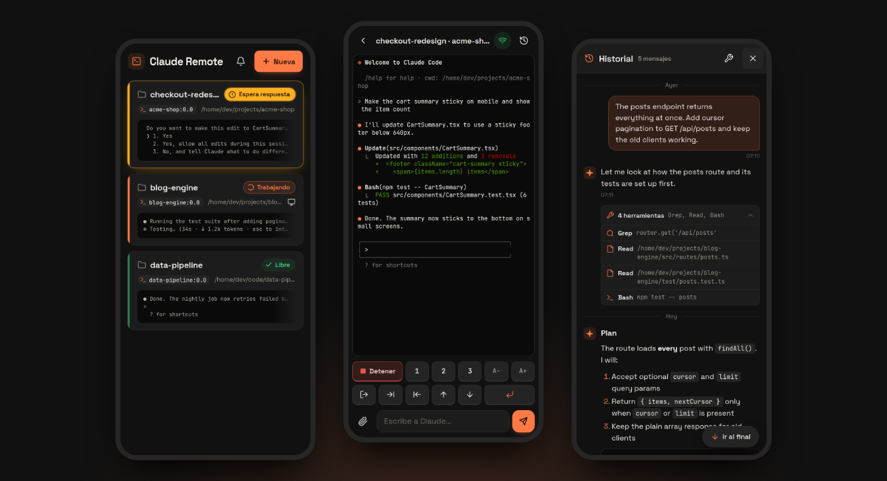
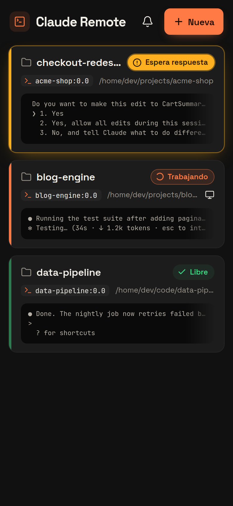
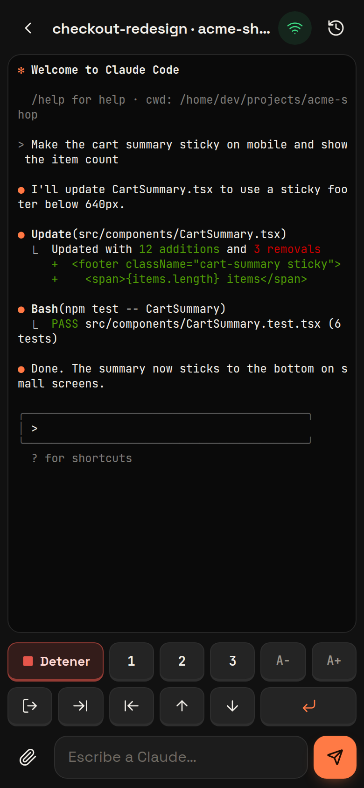
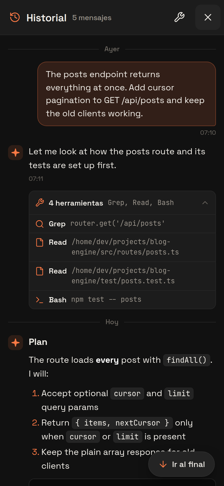
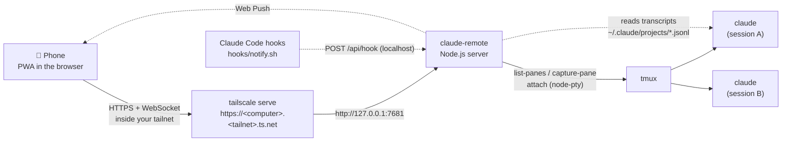
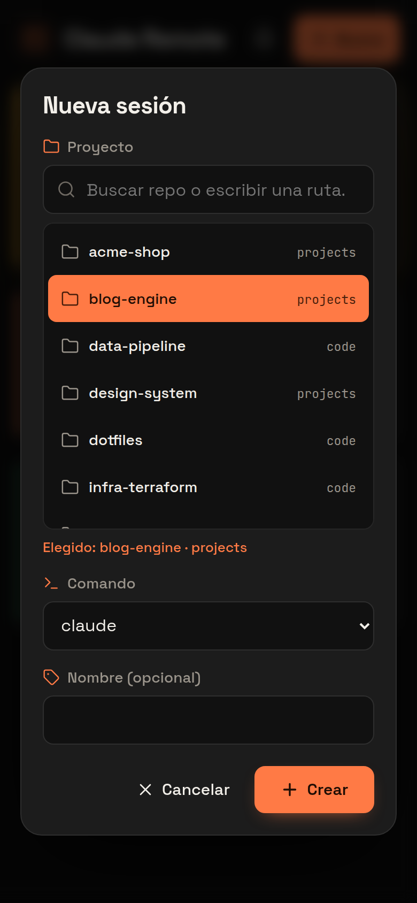
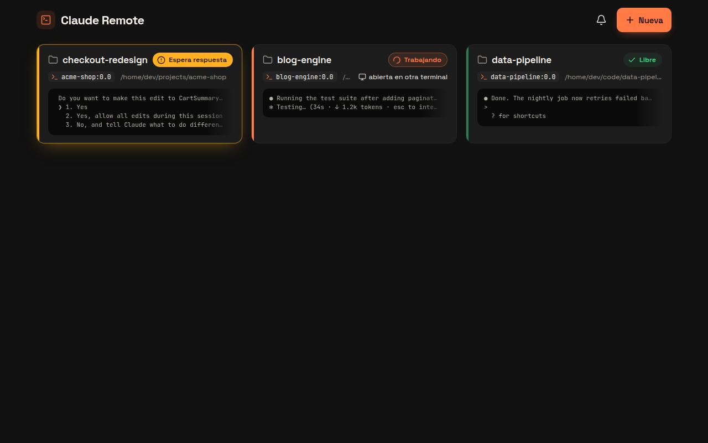
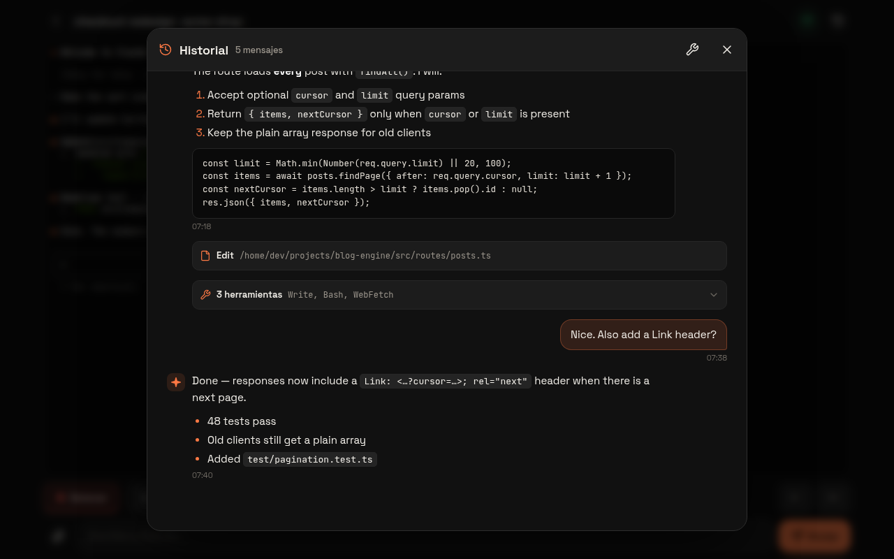

<div align="center">

# claude-remote

**Drive the Claude Code sessions running on your computer from your phone.**

A small, self-hosted PWA that lists every Claude Code session running in tmux, shows what each one is doing,
and lets you answer, approve, interrupt and start sessions from anywhere, privately through your Tailscale network.

[](https://nodejs.org)
[](LICENSE)
[](#6-install-it-on-your-phone)
[](https://tailscale.com)

**English** · [Español](README.es.md)



</div>

> [!NOTE]
> The app's interface is in **Spanish** (for example, *Nueva* = New, *Espera respuesta* = Waiting for you,
> *Trabajando* = Working, *Libre* = Idle, *Detener* = Stop). This README translates every label it mentions.

---

## Contents

- [What it is](#what-it-is)
- [Features](#features)
- [How it works](#how-it-works)
- [Requirements](#requirements)
- [Installation](#installation)
- [Using the app](#using-the-app)
- [The `ct` helper](#the-ct-helper)
- [Configuration](#configuration)
- [Security model](#security-model)
- [Troubleshooting / FAQ](#troubleshooting--faq)
- [Contributing](#contributing)
- [License](#license)

## What it is

You start Claude Code on your computer, it works for a while, and then it stops to ask
*"Do you want to make this edit?"* while you're away from the desk. **claude-remote** lets you
answer from your phone.

It doesn't use any Claude Code "remote" feature. It relies on two things you may already use:

- **tmux**: your Claude Code sessions run inside tmux panes, so they keep running and anyone with the right access can attach to them.
- **Tailscale**: your phone reaches your computer over your private tailnet with real HTTPS (`tailscale serve`), with no open ports and nothing exposed to the internet.

The server is a single Node.js process (no framework, no build step) bound to `127.0.0.1`.

## Features

| | |
|---|---|
| 🗂️ **Session list with live status** | Finds every tmux pane whose process tree runs `claude` and shows it as a card. The status is **Espera respuesta** (waiting for you, amber and pulsing), **Trabajando** (working, orange spinner) or **Libre** (idle, green), next to the last lines on screen. Sessions waiting for you are sorted first, and the tab title shows how many there are. The list refreshes every 3 s; pull down to refresh it right away. |
| 🖥️ **Live terminal** | Opens the real tmux session in [xterm.js](https://xtermjs.org) over a WebSocket. It's the same session you see on your computer, not a copy. |
| ⌨️ **Special keys + Detener** | A two-row key pad: `1` `2` `3` to answer menus, `Esc`, `Tab`, `⇧Tab` to switch modes, `↑` `↓`, `⏎`, font size `A−`/`A+`, and a red **Detener** button that sends **Ctrl+C**. |
| ✍️ **Prompt box** | Write long prompts comfortably. Multi-line text is sent as a bracketed paste, so line breaks don't submit early. **Ctrl/⌘+Enter** sends. |
| 📎 **Attach images** | Pick a photo or screenshot. It is shrunk to a 2000 px maximum on the phone, uploaded to your computer, and its path is pasted into Claude, which attaches it as `[Image #N]`. |
| 💬 **Chat-style history** | Reads the session's Claude Code transcript (`.jsonl`) and shows it as a chat: your messages, Claude's answers with Markdown and code blocks, and tool calls grouped into collapsible rows. If no transcript is found, it falls back to the tmux scrollback. |
| 🔔 **Push notifications** | With the optional Claude Code hooks, your phone gets a notification when Claude needs permission or your attention. Tapping it opens that session. |
| ➕ **New session with project search** | Start Claude in any of your repos: search by name or folder (accents and case ignored, recent ones first) or type a path. Choose which command or alias to run and, optionally, a session name. |
| 🏷️ **`/rename` titles** | If you named a conversation with Claude Code's `/rename`, that name is shown instead of the folder name. |
| 📱 **Installable PWA** | Add it to your home screen and it opens full screen like a native app. Built mobile-first with safe-area support, big touch targets and a dark graphite theme with orange accents. Works fine on desktop too. |

<table>
<tr>
<td align="center"><br><sub>Session list</sub></td>
<td align="center"><br><sub>Live terminal + keys</sub></td>
<td align="center"><br><sub>Chat-style history</sub></td>
</tr>
</table>

## How it works



<details>
<summary>Plain-text version</summary>

```
Phone (PWA) ──HTTPS via Tailscale──▶ tailscale serve ──▶ claude-remote (127.0.0.1:7681) ──▶ tmux ──▶ claude
                                                              ▲
                          Claude Code hook (notify.sh) ───────┘ ──Web Push──▶ phone
```
</details>

- **Discovery**: `tmux list-panes -a`, then for each pane it walks the process tree in `/proc` looking for a process named `claude`.
- **Status**: guessed from what's on screen. A permission or choice prompt means *waiting*, "esc to interrupt" means *working*, anything else is *idle*.
- **Terminal**: `node-pty` runs `tmux attach-session -t <pane>` and streams it to xterm.js. Closing the page detaches; it never kills the session.
- **History**: finds the session's transcript through `/proc/<pid>/environ` (`CLAUDE_CONFIG_DIR`) and `<config>/sessions/<pid>.json`, then parses the last 8 MB of the `.jsonl`.
- **Notifications**: Claude Code `Notification` and `Stop` hooks `curl` the local server, which sends a Web Push (VAPID) to your subscribed devices. No notification is sent for a session you're currently viewing in the app.

## Requirements

| | |
|---|---|
| **OS** | **Linux.** Session detection reads `/proc`, so macOS and Windows are not supported as the host. Any phone or desktop browser works as the client. |
| **Node.js** | ≥ 20 |
| **Build tools** | `node-pty` is a native module: you need `python3`, `make` and a C++ compiler (`sudo apt install build-essential python3`) |
| **tmux** | `sudo apt install tmux` |
| **Claude Code** | The `claude` CLI, or a shell alias or wrapper for it |
| **Tailscale** | On the computer and the phone, with **MagicDNS** and **HTTPS certificates** enabled in the admin console (DNS → HTTPS Certificates) |
| **systemd** *(optional)* | To start it automatically as a user service |

## Installation

### 1. Clone and install

```bash
git clone https://github.com/egoan82/claude-remote.git ~/claude-remote
cd ~/claude-remote
make install          # npm ci (builds node-pty and generates the app icons)
```

### 2. Try it locally

```bash
make start            # same as: PORT=7681 node server.js
```

Open <http://localhost:7681> on the same computer. Local access is always allowed.
Start a session in another terminal with `ct` (see [below](#the-ct-helper)) or plain `tmux new -s demo claude`, and it shows up in the list.

### 3. Run it as a service (systemd user unit)

`claude-remote.service` is a **template**. Edit it before installing it:

```ini
WorkingDirectory=%h/claude-remote                   # where you cloned it
Environment=PATH=%h/.local/bin:/usr/local/bin:/usr/bin:/bin   # node, tmux and claude must be here (add nvm's bin if you use it)
Environment=ALLOWED_LOGINS=you@example.com          # your Tailscale login
Environment=ALLOWED_IPS=100.x.y.z,100.a.b.c         # your phone's (and this computer's) Tailscale IPs
Environment=CLAUDE_CMDS=claude                      # commands/aliases offered by "Nueva"
Environment=PROJECT_ROOTS=%h/projects:%h/code       # where your repos live
```

Then:

```bash
make install-service  # copies it to ~/.config/systemd/user and enables it (starts at login)
make status           # service status + tailscale serve status
```

`KillMode=process` makes sure that restarting the service never kills your tmux sessions.
To remove it: `make uninstall-service`.

> [!TIP]
> To keep it running after you log out, enable lingering: `loginctl enable-linger $USER`.

### 4. Publish it to your tailnet

```bash
make serve            # tailscale serve --bg --https=443 http://127.0.0.1:7681
```

Your app is now at `https://<computer>.<tailnet>.ts.net` (shown by `tailscale serve status`), **only inside your tailnet**.
`make unserve` turns it off.

> [!IMPORTANT]
> Access through the tailnet is **denied by default**. Set `ALLOWED_LOGINS` and/or `ALLOWED_IPS`
> (or, if you really want every device in your tailnet to have a shell, `ALLOW_ANY_TAILNET=1`).
> Find the IPs with `tailscale status` / `tailscale ip -4`.

**Optional: lock it down at the network level.** [`docs/tailscale-acl.hujson`](docs/tailscale-acl.hujson) is an example
Tailscale policy where only your phone can reach your computer. Replace the example hosts and IPs with your own,
merge it into *Access controls* in the Tailscale admin console, and use *Preview rules* before saving.

### 5. Push notifications (optional)

Register the hooks in every Claude Code config directory you use:

```bash
make hooks DIRS="~/.claude"
# several configs (e.g. a work profile using CLAUDE_CONFIG_DIR=~/.claude-work):
make hooks DIRS="~/.claude ~/.claude-work"
```

This adds a `Notification` and a `Stop` hook that run `hooks/notify.sh`. The script is idempotent, and it backs up
`settings.json` to `settings.json.bak-claude-remote` before writing. The hook never blocks Claude: it uses a 3 s timeout
and always exits 0, so nothing happens if the server is down.

- You get a notification when Claude **needs permission** or **your attention**.
- "Finished and waiting for your next message" notifications are **off by default** because they're too frequent. Turn them on with `NOTIFY_ON_STOP=1`.
- If the hook can't reach the server on 7681 (custom port), set `CLAUDE_REMOTE_PORT` in the environment Claude runs in.

### 6. Install it on your phone

1. Open Tailscale on the phone, then open `https://<computer>.<tailnet>.ts.net` in the browser.
2. **Android/Chrome**: menu ⋮ → *Add to Home screen*. **iPhone/Safari**: Share → *Add to Home Screen*.
3. Open it from the home screen and tap the 🔔 bell to enable notifications. A test notification confirms it works.

HTTPS is required both to install the PWA and to receive push, which is why it goes through `tailscale serve`.

## Using the app

### Session list


Every Claude Code session running in tmux appears as a card:

- **Name**: the `/rename` title, or the folder name.
- **Status badge**:
  - 🟠 **Espera respuesta**: Claude is waiting for you (a permission or choice prompt). These cards glow amber and are sorted first.
  - 🔶 **Trabajando**: Claude is working.
  - 🟢 **Libre**: idle, ready for a new prompt.
- **Meta line**: the tmux target (`session:window.pane`), the working directory, and a 🖥️ monitor icon if the session is also attached in another terminal.
- **Preview**: the last lines on screen.

Tap a card to open it. The list refreshes every 3 seconds while visible; **pull down** to refresh right away.
With no sessions you get an empty state that explains how to start one. If the server can't be reached, a red banner says so.

<br clear="right">

### New session (“Nueva”)



Tap **Nueva** in the header:

1. **Proyecto**: search your repos. Every git repository directly inside a `PROJECT_ROOTS` folder is listed. The search matches name and parent folder, ignores accents and case, and shows recently used projects first. You can also type a path starting with `/` or `~/`. **Enter** picks the first result.
2. **Comando**: which command or alias to run (from `CLAUDE_CMDS`). It remembers your last choice.
3. **Nombre (opcional)**: tmux session name. It defaults to the folder name, with `-2`, `-3`… added if that name is taken.
4. **Crear** starts it detached: `tmux new-session -d -c <dir> $SHELL -ilc '<cmd>; exec $SHELL -il'`. It uses an interactive login shell, so your aliases and PATH work, and you get a shell back when Claude exits.

<br clear="right">

### Terminal


The real tmux session, live. The header shows the session name, a **connection** indicator (green Wi-Fi when connected, red crossed-out Wi-Fi when disconnected; it reconnects automatically) and the **history** button.

| Key | Sends | Use it for |
|---|---|---|
| **Detener** | `Ctrl+C` | Interrupt / stop Claude |
| `1` `2` `3` | the digit | Answer numbered menus ("1. Yes / 2. … / 3. No") |
| `A−` `A+` | — | Terminal font size (remembered on the device) |
| ⎋ **Esc** | `Esc` | Cancel / go back in Claude's UI |
| ⇥ **Tab** | `Tab` | Autocomplete |
| ⇤ **⇧Tab** | `Shift+Tab` | Cycle modes (e.g. auto-accept edits / plan mode) |
| ↑ ↓ | arrow keys | Move through menus and prompt history |
| ↵ **Enter** | `Enter` | Confirm |

The keys never steal focus, so the phone keyboard stays open.

**Prompt box**: type and tap the send button (**Enviar**). Sending an empty box just presses Enter.
Multi-line prompts are sent as a bracketed paste. **Ctrl/⌘+Enter** sends from a hardware keyboard.

**📎 Attach image**: pick an image (png, jpg, gif, webp, up to 20 MB). Large photos are resized to 2000 px and re-encoded as JPEG on the phone.
The file is saved on the computer in `$TMPDIR/claude-remote-uploads/` (mode 0700, deleted after a day) and its path is pasted into the prompt.

<br clear="right">

### History


Tap the clock icon for a readable version of the whole conversation:

- **Your messages** are on the right in orange bubbles. **Claude's** are on the left with Markdown: headings, lists, bold, inline code and horizontally scrollable code blocks.
- **Tool calls** appear as compact rows with an icon per type (terminal for Bash, file for Read/Edit/Write, magnifier for Grep/Glob, globe for web tools, robot for agents). Consecutive calls collapse into **“N herramientas”**; tap to expand.
- **Timestamps** (HH:MM) and day separators (*Hoy* = today, *Ayer* = yesterday).
- The 🔧 button hides or shows tool calls and is remembered on the device. **Ir al final** jumps to the bottom. Long conversations render the last 300 messages first; **Cargar anteriores** loads earlier ones.
- If the transcript can't be found (e.g. a session not started by Claude Code), it shows the tmux scrollback as plain text.

Transcript content is always HTML-escaped before formatting.

<br clear="right">

### Desktop

It works on a desktop browser too: the list becomes a grid and the history opens as a centered panel.




## The `ct` helper

Only sessions running **inside tmux** can be driven from the phone. `bin/ct` makes that the default way to start Claude:

```bash
make link-ct                     # symlink to ~/.local/bin/ct

cd ~/projects/myapp
ct                               # tmux session "myapp" running claude (attaches if it already exists)
ct -N                            # always a new session: myapp-2, myapp-3, …
ct -n api                        # session named "api"
ct -- --resume                   # new session, passing arguments to claude (pick an old conversation)
ct -- --continue                 # new session continuing the last conversation
CLAUDE_CMD=claude-work ct        # use another command or shell alias
```

When Claude exits you keep a shell in the same session. Detach without closing Claude with `Ctrl-b d`.
If you started `claude` in a normal terminal, close it and reopen it with `ct -- --continue`.

## Configuration

All settings are environment variables. Put them in the systemd unit, or prefix them to `make start` / `node server.js`.

| Variable | Default | Description |
|---|---|---|
| `PORT` | `7681` | Port the server listens on. |
| `HOST` | `127.0.0.1` | Bind address. **Keep it on localhost.** `tailscale serve` is the only intended way in. |
| `ALLOWED_LOGINS` | *(empty)* | Comma-separated Tailscale logins (e.g. `you@example.com`) allowed through the tailnet. |
| `ALLOWED_IPS` | *(empty)* | Comma-separated Tailscale IPs (`100.x.y.z`) of the devices allowed through the tailnet. If both lists are set, a request must match **both**. |
| `ALLOW_ANY_TAILNET` | *(off)* | `1` allows any device in your tailnet when both lists above are empty. Without it, tailnet access is rejected. |
| `CLAUDE_CMDS` | `claude` | Comma-separated commands or shell aliases offered in *Nueva*; the first is the default. Only `[A-Za-z0-9_.-]` names are accepted. |
| `PROJECT_ROOTS` | `~/projects:~/code:~/src` | Colon-separated folders whose direct children that are git repos are listed in *Nueva*. Missing folders are skipped. |
| `NOTIFY_ON_STOP` | *(off)* | `1` also sends a push each time Claude finishes and waits for you. |
| `DATA_DIR` | `./data` | Where VAPID keys (`vapid.json`) and push subscriptions (`subscriptions.json`) are stored. Created with mode 0700 and generated on first run. |
| `VAPID_SUBJECT` | `mailto:claude-remote@localhost` | Contact URI sent to push services. |
| `SHELL` | `/bin/bash` | Shell used to start new sessions (as an interactive login shell). |
| `CLAUDE_REMOTE_PORT` | `7681` | *(read by `hooks/notify.sh`)* Port the hook posts to. |
| `CLAUDE_CMD` | `claude` | *(read by `bin/ct`)* Command or alias `ct` runs. |

### Make targets

| Target | What it does |
|---|---|
| `make install` | `npm ci`: installs dependencies, builds `node-pty`, generates the icons |
| `make start` | Runs the server in the foreground on `$(PORT)` (default 7681) |
| `make link-ct` | Symlinks `bin/ct` into `~/.local/bin` |
| `make install-service` | Installs and enables the systemd user unit |
| `make uninstall-service` | Disables and removes it |
| `make serve` / `make unserve` | Publishes / unpublishes `https://<computer>.<tailnet>.ts.net` with `tailscale serve` |
| `make hooks DIRS="…"` | Registers the push-notification hooks in those Claude config dirs |
| `make status` | Service status + `tailscale serve status` |

## Security model

> [!WARNING]
> **Anyone who can open this app has a shell on your computer.** They can type into your Claude sessions,
> and start new ones, as your user. Treat access to it like SSH access.
> **Never** expose it with `tailscale funnel`, a reverse proxy or port forwarding.

What protects it:

1. **Localhost only.** The server binds to `127.0.0.1`. The only way in from another device is `tailscale serve`, i.e. from inside your tailnet, over HTTPS.
2. **Host / Origin checks.** Requests (and WebSocket upgrades) whose `Host` or `Origin` isn't `localhost`/`127.0.0.1`/`[::1]` or `*.ts.net` are rejected. A malicious web page open in your desktop browser can't drive the server (CSRF, DNS rebinding).
3. **Tailnet allowlist, closed by default.** Requests arriving through `tailscale serve` carry the device IP (`X-Forwarded-For`) and the Tailscale login (`Tailscale-User-Login`), both set by Tailscale. They must match `ALLOWED_LOGINS` / `ALLOWED_IPS`. With neither set, everything from the tailnet is rejected unless you opt in with `ALLOW_ANY_TAILNET=1`. Rejections are logged.
4. **Hook endpoint is local-only.** `/api/hook` only accepts calls from `127.0.0.1` without an `Origin` and without tailnet headers.
5. **Input validation.** Pane ids, session names and commands are validated (commands must be in `CLAUDE_CMDS`), static file paths are confined to `public/`, uploads are limited to images ≤ 20 MB stored with private permissions, and JSON bodies are size-limited.
6. **Network policy (optional).** Add the [Tailscale ACL example](docs/tailscale-acl.hujson) so only your phone can reach the computer at all.

Found a security issue? Please open a private security advisory on the repository instead of a public issue.

## Troubleshooting / FAQ

<details>
<summary><b>The list is empty, but Claude is running</b></summary>

Only sessions **inside tmux** are detected, and the process must be named `claude`. Start Claude with `ct`,
or inside `tmux`. If you use a wrapper script, make sure it ends up `exec`-ing the real `claude` binary.
</details>

<details>
<summary><b>403 “prohibido” / “acceso rechazado” in the server log</b></summary>

You're coming through the tailnet and you aren't on the allowlist. Check `ALLOWED_LOGINS` / `ALLOWED_IPS`
against `tailscale status`. Tagged devices have no user login, so use their IP. The server log says why each request was rejected:
`journalctl --user -u claude-remote -f`.
</details>

<details>
<summary><b><code>make serve</code> fails or the certificate is invalid</b></summary>

Enable **MagicDNS** and **HTTPS Certificates** in the Tailscale admin console (DNS page). The first HTTPS request can take a few seconds while the certificate is issued.
</details>

<details>
<summary><b>The service can't find <code>node</code>, <code>tmux</code> or <code>claude</code></b></summary>

systemd user units don't load your shell profile. Put the right directories in the unit's `Environment=PATH=…`
(for nvm: `%h/.nvm/versions/node/<version>/bin`). Then run `systemctl --user daemon-reload && systemctl --user restart claude-remote`.
</details>

<details>
<summary><b>No push notifications</b></summary>

- Open the app from the **installed** PWA over HTTPS and tap 🔔: you should get a test notification.
- Make sure the hooks are installed in the config dir Claude actually uses (`make hooks DIRS="…"`), then restart Claude.
- Notifications are skipped for a session you're viewing in the app at that moment.
- "Finished" notifications need `NOTIFY_ON_STOP=1`.
</details>

<details>
<summary><b><code>npm install</code> fails building node-pty</b></summary>

Install the build tools: `sudo apt install build-essential python3`, then `make install` again.
</details>

<details>
<summary><b>The history shows plain text instead of a chat</b></summary>

The transcript couldn't be located (e.g. the session was started with a custom `CLAUDE_CONFIG_DIR` the server can't read, or it isn't Claude Code), so it fell back to the tmux scrollback.
</details>

<details>
<summary><b>Does it work on macOS?</b></summary>

Not as the host: it reads `/proc` to find Claude processes and their transcripts. Contributions welcome.
</details>

## Contributing

Issues and pull requests are welcome. The project is intentionally small:

- **No build step and no framework.** `server.js` + `lib/` on the server, vanilla JS/CSS in `public/`.
- Keep it **mobile-first**: 44 px touch targets, no horizontal scroll at 360 px, inputs ≥ 16 px.
- UI text is in Spanish. If you add strings, keep them consistent with the existing vocabulary.
- Run `node --check` on the files you touch and try the app on a phone-sized viewport before opening a PR.

## License

[MIT](LICENSE) © 2026 Edward Gomez
